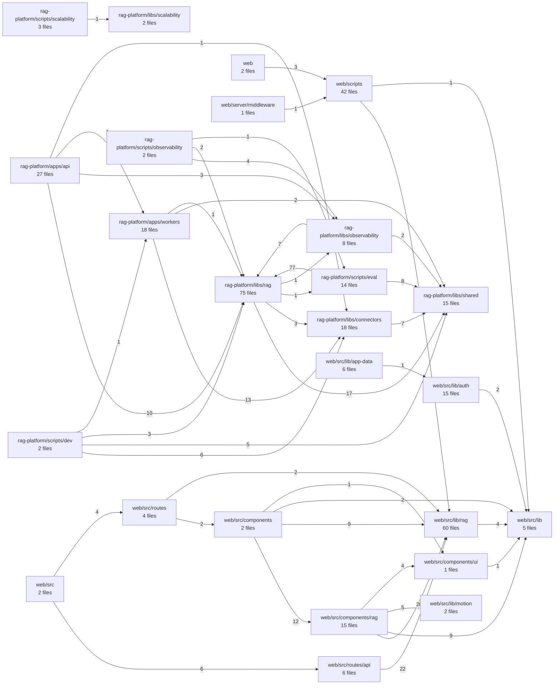

# Code graph

Generated by `node scripts/codegraph.mjs`. Do not edit by hand; regenerate after structural changes.

**495** source files (128 tests) · **1191** resolved import edges · **6** import cycles · machine-readable: [graph.json](graph.json)

## Layer map

Arrows point from importer to imported layer; labels count file-level imports (strongest 45 shown).

## Hubs (highest fan-in)

A change here ripples furthest. Test these first.

| File | Imported by | Imports | LOC |
| --- | ---: | ---: | ---: |
| `web/src/lib/rag/types.ts` | 51 | 0 | 250 |
| `rag-platform/libs/rag/evaluation/models.py` | 30 | 1 | 357 |
| `rag-platform/libs/shared/models/lifecycle.py` | 26 | 0 | 187 |
| `web/src/lib/rag/store.server.ts` | 25 | 11 | 575 |
| `web/src/lib/rag/text.ts` | 21 | 0 | 290 |
| `web/src/lib/rag/retrieve-core.ts` | 20 | 8 | 436 |
| `rag-platform/libs/shared/models/chunk.py` | 19 | 1 | 188 |
| `web/src/lib/rag/storage.ts` | 19 | 1 | 131 |
| `web/src/lib/rag/ingest.server.ts` | 18 | 10 | 564 |
| `rag-platform/libs/rag/generation/service.py` | 17 | 7 | 133 |
| `rag-platform/libs/rag/retrieval/models.py` | 17 | 0 | 34 |
| `rag-platform/libs/rag/chunking/utils.py` | 16 | 0 | 471 |
| `rag-platform/libs/rag/generation/config.py` | 16 | 0 | 49 |
| `web/src/lib/rag/testing/close-database.mjs` | 16 | 0 | 24 |
| `web/src/lib/rag/testing/isolated-pglite-dir.mjs` | 16 | 0 | 15 |

## Import cycles

- `rag-platform/libs/rag/generation/ollama.py` ↔ `rag-platform/libs/rag/generation/service.py`
- `rag-platform/libs/rag/evaluation/models.py` ↔ `rag-platform/libs/rag/evaluation/task_taxonomy.py`
- `rag-platform/libs/rag/evaluation/parameters.py` ↔ `rag-platform/libs/rag/evaluation/platform.py` ↔ `rag-platform/libs/rag/evaluation/report.py`
- `rag-platform/libs/rag/embeddings/__init__.py` ↔ `rag-platform/libs/rag/embeddings/retriever.py`
- `web/src/lib/auth/gates.tsx` ↔ `web/src/lib/auth/use-current-user.ts`
- `web/src/routeTree.gen.ts` ↔ `web/src/router.tsx`

## Unconnected production files

No resolved imports in or out. Entry points (routes, scripts, workers) are expected here; anything else may be dead code.

- `audit/graph-browser.py`
- `audit/ingestion-browser.py`
- `audit/issue-tests.py`
- `audit/live-browser.py`
- `audit/recheck-upstream.py`
- `eval/repo-support/plot_results.py`
- `rag-platform/apps/__init__.py`
- `rag-platform/apps/api/__init__.py`
- `rag-platform/apps/api/app/__init__.py`
- `rag-platform/apps/api/app/adapters/__init__.py`
- `rag-platform/apps/api/app/adapters/ingestion/__init__.py`
- `rag-platform/apps/api/app/adapters/ingestion/repository.py`
- `rag-platform/apps/api/app/api/__init__.py`
- `rag-platform/apps/api/app/api/v1/__init__.py`
- `rag-platform/apps/api/app/core/__init__.py`
- `rag-platform/apps/api/app/health/__init__.py`
- `rag-platform/apps/api/app/schemas/__init__.py`
- `rag-platform/apps/api/app/services/__init__.py`
- `rag-platform/apps/api/app/services/ingestion/__init__.py`
- `rag-platform/apps/api/app/static/app.js`
- `rag-platform/apps/api/app/telemetry/__init__.py`
- `rag-platform/apps/scheduler/__init__.py`
- `rag-platform/apps/scheduler/app/__init__.py`
- `rag-platform/apps/scheduler/app/core/__init__.py`
- `rag-platform/apps/scheduler/app/jobs/__init__.py`
- `rag-platform/apps/scheduler/app/main.py`
- `rag-platform/apps/workers/__init__.py`
- `rag-platform/apps/workers/app/__init__.py`
- `rag-platform/apps/workers/app/adapters/__init__.py`
- `rag-platform/apps/workers/app/core/__init__.py`
- `rag-platform/apps/workers/app/main.py`
- `rag-platform/apps/workers/app/pipelines/__init__.py`
- `rag-platform/apps/workers/app/schemas/__init__.py`
- `rag-platform/apps/workers/app/tasks/__init__.py`
- `rag-platform/apps/workers/app/tasks/ingestion/__init__.py`
- `rag-platform/apps/workers/app/telemetry/__init__.py`
- `rag-platform/libs/__init__.py`
- `rag-platform/libs/connectors/__init__.py`
- `rag-platform/libs/connectors/sinks/__init__.py`
- `rag-platform/libs/connectors/sinks/postgres/__init__.py`
- `rag-platform/libs/connectors/sources/__init__.py`
- `rag-platform/libs/connectors/sources/github/__init__.py`
- `rag-platform/libs/connectors/sources/markdown/__init__.py`
- `rag-platform/libs/rag/__init__.py`
- `rag-platform/libs/rag/prompting/__init__.py`
- `rag-platform/libs/shared/__init__.py`
- `rag-platform/libs/shared/auth/__init__.py`
- `rag-platform/libs/shared/config/__init__.py`
- `rag-platform/libs/shared/models/__init__.py`
- `rag-platform/libs/shared/models/ingestion/__init__.py`
- `rag-platform/libs/shared/models/raw_payload.py`
- `rag-platform/libs/shared/tracing/__init__.py`
- `rag-platform/libs/shared/utils/__init__.py`
- `rag-platform/scripts/eval/compare_baseline.py`
- `rag-platform/scripts/scalability/generate_synthetic_corpus.py`
- `rag-platform/scripts/scalability/run_load_test.py`
- `scripts/codegraph.mjs`
- `web/eslint.config.mjs`
- `web/scripts/acceptance-hybrid.mjs`
- `web/scripts/audit-graph-provenance.mjs`
- `web/scripts/copy-pglite-assets.mjs`
- `web/scripts/encode-walkthrough.mjs`
- `web/scripts/export-pilot.mjs`
- `web/scripts/fresh-source-audit.mjs`
- `web/scripts/graph-provider-summary.ts`
- `web/scripts/grok-pwa-shared.d.mts`
- `web/scripts/narrate-walkthrough.mjs`
- `web/scripts/production-acceptance.mjs`
- `web/scripts/record-walkthrough.mjs`
- `web/scripts/repo-support-judge.mjs`
- `web/scripts/verify-graph-story.mjs`
- `web/scripts/verify-walkthrough.mjs`
- `web/scripts/verify-workspace.mjs`

## Index by layer

<b>audit</b> · 5 files

- `audit/graph-browser.py` (in 0 / out 0) — `run`, `ev`, `click`
- `audit/ingestion-browser.py` (in 0 / out 0) — `run`
- `audit/issue-tests.py` (in 0 / out 0) — `run`, `ev`
- `audit/live-browser.py` (in 0 / out 0) — `browser`, `ev`
- `audit/recheck-upstream.py` (in 0 / out 0) — `run`

<b>eval/repo-support</b> · 1 files

- `eval/repo-support/plot_results.py` (in 0 / out 0)

<b>rag-platform/apps</b> · 1 files

- `rag-platform/apps/__init__.py` (in 0 / out 0)

<b>rag-platform/apps/api</b> · 27 files

- `rag-platform/apps/api/__init__.py` (in 0 / out 0)
- `rag-platform/apps/api/app/__init__.py` (in 0 / out 0)
- `rag-platform/apps/api/app/adapters/__init__.py` (in 0 / out 0)
- `rag-platform/apps/api/app/adapters/ingestion/__init__.py` (in 0 / out 0)
- `rag-platform/apps/api/app/adapters/ingestion/celery_client.py` (in 1 / out 1) — `enqueue_task`
- `rag-platform/apps/api/app/adapters/ingestion/repository.py` (in 0 / out 0) — `IngestionRepository`
- `rag-platform/apps/api/app/api/__init__.py` (in 0 / out 0)
- `rag-platform/apps/api/app/api/v1/__init__.py` (in 0 / out 0)
- `rag-platform/apps/api/app/api/v1/ingestion.py` (in 1 / out 5) — `ingest_github_issues`, `ingest_github_comments`, `get_ingestion_run`, `list_ingestion_runs`
- `rag-platform/apps/api/app/api/v1/query.py` (in 2 / out 3) — `query_rag`, `query_rag_stream`, `query_health`, `query_sources`
- `rag-platform/apps/api/app/core/__init__.py` (in 0 / out 0)
- `rag-platform/apps/api/app/health/__init__.py` (in 0 / out 0)
- `rag-platform/apps/api/app/main.py` (in 1 / out 5) — `lifespan`, `serve_source_document`
- `rag-platform/apps/api/app/middleware/__init__.py` (in 0 / out 1)
- `rag-platform/apps/api/app/middleware/webhook.py` (in 2 / out 0) — `verify_webhook_signature`
- `rag-platform/apps/api/app/schemas/__init__.py` (in 0 / out 0)
- `rag-platform/apps/api/app/schemas/ingestion_runs.py` (in 1 / out 0) — `IngestionRunResponse`, `IngestionRunEventResponse`, `IngestionStatsResponse`
- `rag-platform/apps/api/app/schemas/ingestion.py` (in 1 / out 0) — `GitHubIngestionRequest`, `GitHubCommentsIngestionRequest`
- `rag-platform/apps/api/app/schemas/query.py` (in 1 / out 0) — `QueryRequest`, `CitationResponse`, `QueryResponse`
- `rag-platform/apps/api/app/services/__init__.py` (in 0 / out 0)
- `rag-platform/apps/api/app/services/ingestion/__init__.py` (in 0 / out 0)
- `rag-platform/apps/api/app/services/ingestion/service.py` (in 1 / out 1) — `IngestionService`
- `rag-platform/apps/api/app/services/query/intents.py` (in 3 / out 0) — `QueryIntent`, `classify_intent`, `example_questions_for`
- `rag-platform/apps/api/app/services/query/service.py` (in 3 / out 13) — `QueryService`
- `rag-platform/apps/api/app/services/query/sources.py` (in 3 / out 1) — `list_sources`, `get_source`, `resolve_doc_id`
- `rag-platform/apps/api/app/static/app.js` (in 0 / out 0)
- `rag-platform/apps/api/app/telemetry/__init__.py` (in 0 / out 0)

<b>rag-platform/apps/scheduler</b> · 5 files

- `rag-platform/apps/scheduler/__init__.py` (in 0 / out 0)
- `rag-platform/apps/scheduler/app/__init__.py` (in 0 / out 0)
- `rag-platform/apps/scheduler/app/core/__init__.py` (in 0 / out 0)
- `rag-platform/apps/scheduler/app/jobs/__init__.py` (in 0 / out 0)
- `rag-platform/apps/scheduler/app/main.py` (in 0 / out 0)

<b>rag-platform/apps/workers</b> · 18 files

- `rag-platform/apps/workers/__init__.py` (in 0 / out 0)
- `rag-platform/apps/workers/app/__init__.py` (in 0 / out 0)
- `rag-platform/apps/workers/app/adapters/__init__.py` (in 0 / out 0)
- `rag-platform/apps/workers/app/core/__init__.py` (in 0 / out 0)
- `rag-platform/apps/workers/app/core/celery_app.py` (in 4 / out 1) — `RetryableTaskError`, `PermanentTaskError`, `get_retry_kwargs`
- `rag-platform/apps/workers/app/main.py` (in 0 / out 0)
- `rag-platform/apps/workers/app/pipelines/__init__.py` (in 0 / out 0)
- `rag-platform/apps/workers/app/schemas/__init__.py` (in 0 / out 0)
- `rag-platform/apps/workers/app/tasks/__init__.py` (in 0 / out 0)
- `rag-platform/apps/workers/app/tasks/ingestion/__init__.py` (in 0 / out 0)
- `rag-platform/apps/workers/app/tasks/ingestion/github/__init__.py` (in 0 / out 1)
- `rag-platform/apps/workers/app/tasks/ingestion/github/pipeline.py` (in 5 / out 9) — `IngestionResult`, `atomic_file_write`, `AtomicRawPayloadStore`, `ingest_github_issues_to_postgres`, `ingest_github_comments_to_postgres`, `reprocess_github_payloads_to_postgres`
- `rag-platform/apps/workers/app/tasks/ingestion/github/tasks.py` (in 1 / out 8) — `ingest_github_issues`, `ingest_github_issue_comments`, `reprocess_github_document`
- `rag-platform/apps/workers/app/tasks/ingestion/markdown/__init__.py` (in 0 / out 1)
- `rag-platform/apps/workers/app/tasks/ingestion/markdown/tasks.py` (in 1 / out 0) — `ingest_markdown_documents`
- `rag-platform/apps/workers/app/tasks/processing/__init__.py` (in 0 / out 1)
- `rag-platform/apps/workers/app/tasks/processing/tasks.py` (in 1 / out 2) — `process_document_task`
- `rag-platform/apps/workers/app/telemetry/__init__.py` (in 0 / out 0)

<b>rag-platform/libs</b> · 1 files

- `rag-platform/libs/__init__.py` (in 0 / out 0)

<b>rag-platform/libs/connectors</b> · 18 files

- `rag-platform/libs/connectors/__init__.py` (in 0 / out 0)
- `rag-platform/libs/connectors/sinks/__init__.py` (in 0 / out 0)
- `rag-platform/libs/connectors/sinks/filesystem/__init__.py` (in 0 / out 1)
- `rag-platform/libs/connectors/sinks/filesystem/raw_payload_store.py` (in 4 / out 0) — `RawPayloadStore`
- `rag-platform/libs/connectors/sinks/postgres/__init__.py` (in 0 / out 0)
- `rag-platform/libs/connectors/sinks/postgres/chunk_repository.py` (in 2 / out 2) — `ChunkRepository`
- `rag-platform/libs/connectors/sinks/postgres/chunk_utils.py` (in 2 / out 1) — `chunk_to_row`
- `rag-platform/libs/connectors/sinks/postgres/document_repository.py` (in 5 / out 1) — `PostgresDocumentRepository`
- `rag-platform/libs/connectors/sinks/postgres/ingestion_run_repository.py` (in 5 / out 0) — `IngestionRunRepository`
- `rag-platform/libs/connectors/sinks/postgres/raw_payload_repository.py` (in 4 / out 0) — `RawPayloadRepository`
- `rag-platform/libs/connectors/sources/__init__.py` (in 0 / out 0)
- `rag-platform/libs/connectors/sources/github/__init__.py` (in 0 / out 0)
- `rag-platform/libs/connectors/sources/github/fetcher.py` (in 3 / out 1) — `GitHubFetcher`
- `rag-platform/libs/connectors/sources/github/schemas.py` (in 2 / out 1) — `GitHubUser`, `GitHubLabel`, `GitHubIssuePayload`, `GitHubCommentPayload`, `categorize_validation_error`
- `rag-platform/libs/connectors/sources/github/transformer.py` (in 5 / out 2) — `GitHubTransformer`
- `rag-platform/libs/connectors/sources/github/utils.py` (in 1 / out 0) — `handle_rate_limit`, `get_next_link`
- `rag-platform/libs/connectors/sources/markdown/__init__.py` (in 0 / out 0)
- `rag-platform/libs/connectors/sources/markdown/transformer.py` (in 0 / out 1) — `MarkdownTransformer`

<b>rag-platform/libs/observability</b> · 8 files

- `rag-platform/libs/observability/__init__.py` (in 2 / out 7)
- `rag-platform/libs/observability/api.py` (in 4 / out 5) — `create_observability_app`
- `rag-platform/libs/observability/collector.py` (in 6 / out 3) — `ObservabilitySnapshot`, `ObservabilityCollector`
- `rag-platform/libs/observability/dashboard.py` (in 4 / out 1) — `DashboardPanel`, `Dashboard`
- `rag-platform/libs/observability/health.py` (in 4 / out 0) — `HealthStatus`, `ComponentHealth`, `SystemHealth`, `HealthChecker`
- `rag-platform/libs/observability/metrics.py` (in 5 / out 0) — `MetricSample`, `Counter`, `Gauge`, `Histogram`, `MetricsRegistry`, `get_registry`, `reset_registry`
- `rag-platform/libs/observability/pipeline.py` (in 4 / out 11) — `ObservedQueryResult`, `ObservedRAGPipeline`
- `rag-platform/libs/observability/tracing.py` (in 5 / out 1) — `SpanEvent`, `Span`, `Trace`, `Tracer`, `SpanContext`, `get_recent_traces`, `clear_traces`

<b>rag-platform/libs/rag</b> · 75 files

- `rag-platform/libs/rag/__init__.py` (in 0 / out 0)
- `rag-platform/libs/rag/chunking/__init__.py` (in 0 / out 8)
- `rag-platform/libs/rag/chunking/base.py` (in 14 / out 1) — `ChunkerConfig`, `BaseChunker`
- `rag-platform/libs/rag/chunking/factory.py` (in 5 / out 7) — `get_chunker`, `get_chunker_for_strategy`, `register_chunker`, `ChunkerFactory`
- `rag-platform/libs/rag/chunking/github_chunker.py` (in 5 / out 4) — `GitHubComment`, `GitHubIssueChunker`
- `rag-platform/libs/rag/chunking/hybrid.py` (in 2 / out 5) — `HybridChunker`
- `rag-platform/libs/rag/chunking/recursive.py` (in 5 / out 3) — `RecursiveChunker`
- `rag-platform/libs/rag/chunking/semantic.py` (in 3 / out 3) — `SemanticChunkerConfig`, `SemanticChunker`
- `rag-platform/libs/rag/chunking/service.py` (in 9 / out 6) — `ChunkingServiceConfig`, `ChunkingJobResult`, `ChunkingService`, `chunk_registered_document`
- `rag-platform/libs/rag/chunking/structure_aware.py` (in 6 / out 3) — `MarkdownSection`, `StructureAwareChunker`
- `rag-platform/libs/rag/chunking/utils.py` (in 16 / out 0) — `estimate_token_count`, `chars_for_tokens`, `normalize_whitespace`, `NormalizationMap`, `normalize_whitespace_with_map`, `remap_offsets_to_source`, `find_code_blocks`, `find_numbered_lists`
- `rag-platform/libs/rag/context/__init__.py` (in 0 / out 7)
- `rag-platform/libs/rag/context/budget.py` (in 3 / out 1) — `pack_by_budget`
- `rag-platform/libs/rag/context/compression.py` (in 3 / out 2) — `compress_extractive`
- `rag-platform/libs/rag/context/config.py` (in 8 / out 0) — `ContextAssemblyConfig`
- `rag-platform/libs/rag/context/deduplication.py` (in 4 / out 1) — `jaccard_similarity`, `deduplicate_by_similarity`, `deduplicate_exact`
- `rag-platform/libs/rag/context/models.py` (in 12 / out 0) — `ContextChunk`, `AssemblyStats`, `AssembledContext`
- `rag-platform/libs/rag/context/selection.py` (in 3 / out 2) — `maximal_marginal_relevance`, `select_top_k`
- `rag-platform/libs/rag/context/service.py` (in 8 / out 9) — `ContextAssemblyService`
- `rag-platform/libs/rag/embeddings/__init__.py` (in 3 / out 4)
- `rag-platform/libs/rag/embeddings/config.py` (in 4 / out 0) — `EmbeddingProvider`, `EmbeddingModel`, `EmbeddingConfig`
- `rag-platform/libs/rag/embeddings/embedder.py` (in 4 / out 1) — `Embedder`, `create_embedder`
- `rag-platform/libs/rag/embeddings/retriever.py` (in 1 / out 3) — `NomicEmbeddingRetriever`, `MultiModelRetriever`
- `rag-platform/libs/rag/evaluation/__init__.py` (in 1 / out 15)
- `rag-platform/libs/rag/evaluation/adversarial.py` (in 4 / out 3) — `CanaryConfig`, `AdversarialResult`, `AdversarialReport`, `AdversarialProbe`
- `rag-platform/libs/rag/evaluation/baseline.py` (in 5 / out 0) — `BaselineMetrics`, `DeltaResult`, `welch_t_test`, `BaselineStore`
- `rag-platform/libs/rag/evaluation/benchmark.py` (in 6 / out 7) — `BenchmarkConfig`, `SimpleRetriever`, `EmbeddingRetriever`, `ChunkingBenchmark`, `quick_benchmark`
- `rag-platform/libs/rag/evaluation/context_benchmark.py` (in 3 / out 6) — `ContextEvalResult`, `ContextBenchmarkResult`, `ContextComparisonReport`, `ContextBenchmark`
- `rag-platform/libs/rag/evaluation/failure_feed.py` (in 3 / out 1) — `FailureRecord`, `FailureFeed`
- `rag-platform/libs/rag/evaluation/faithfulness.py` (in 8 / out 5) — `EntailmentLabel`, `ClaimEvaluation`, `FaithfulnessResult`, `JudgeClient`, `LexicalJudge`, `OllamaJudge`, `FaithfulnessEvaluator`
- `rag-platform/libs/rag/evaluation/generation_benchmark.py` (in 4 / out 7) — `GenerationEvalResult`, `GenerationBenchmarkResult`, `GenerationComparisonReport`, `GenerationBenchmark`
- `rag-platform/libs/rag/evaluation/metrics.py` (in 6 / out 0) — `DistributionStats`, `compute_distribution`, `LayerMetrics`
- `rag-platform/libs/rag/evaluation/models.py` (in 30 / out 1) — `EvaluationSample`, `EvaluationDataset`, `ChunkingEvalResult`, `StrategyComparison`
- `rag-platform/libs/rag/evaluation/parameters.py` (in 10 / out 1) — `PipelineParameters`
- `rag-platform/libs/rag/evaluation/platform.py` (in 9 / out 18) — `PipelineHandles`, `EvaluationPlatform`
- `rag-platform/libs/rag/evaluation/quality_gate.py` (in 5 / out 3) — `GateVerdict`, `GateCheck`, `QualityGateResult`, `QualityGate`
- `rag-platform/libs/rag/evaluation/ragas_wrapper.py` (in 7 / out 0) — `LLMProvider`, `OllamaConfig`, `OpenAIConfig`, `HuggingFaceConfig`, `RagasConfig`, `RagasEvaluator`, `create_ollama_evaluator`, `create_openai_evaluator`
- `rag-platform/libs/rag/evaluation/report.py` (in 4 / out 5) — `EvalReport`
- `rag-platform/libs/rag/evaluation/reranking_benchmark.py` (in 3 / out 5) — `RerankEvalResult`, `RerankBenchmarkResult`, `RerankComparisonReport`, `RerankingBenchmark`
- `rag-platform/libs/rag/evaluation/retrieval_benchmark.py` (in 6 / out 2) — `RetrievalEvalSample`, `RetrievalEvalResult`, `RetrievalBenchmarkResult`, `recall_at_k`, `precision_at_k`, `mrr`, `ndcg_at_k`, `RetrievalBenchmark`
- `rag-platform/libs/rag/evaluation/sample_dataset.py` (in 4 / out 2) — `create_sample_kubernetes_dataset`, `create_sample_runbook_dataset`, `create_combined_sample_dataset`, `get_sample_documents`, `run_sample_benchmark`
- `rag-platform/libs/rag/evaluation/sota_comparison.py` (in 3 / out 11) — `SOTAConfig`, `SOTARunResult`, `SOTAComparisonReport`, `SOTAComparisonRunner`, `save_sota_baselines`
- `rag-platform/libs/rag/evaluation/task_eval.py` (in 4 / out 7) — `TaskThresholds`, `TaskEvalResult`, `TaskEvalReport`, `TaskEvaluator`, `compute_task_composite_score`
- `rag-platform/libs/rag/evaluation/task_taxonomy.py` (in 3 / out 1) — `TaskType`, `resolve_task_type`, `task_metadata`
- `rag-platform/libs/rag/evaluation/thresholds.py` (in 10 / out 0) — `ThresholdLevel`, `MetricThreshold`, `QualityGateConfig`
- `rag-platform/libs/rag/generation/__init__.py` (in 1 / out 4)
- `rag-platform/libs/rag/generation/citations.py` (in 4 / out 2) — `normalize_answer_citations`, `build_source_index`, `parse_citations`, `extract_claims`, `citations_for_claim`, `strip_unresolved_citations`
- `rag-platform/libs/rag/generation/config.py` (in 16 / out 0) — `GenerationConfig`
- `rag-platform/libs/rag/generation/models.py` (in 10 / out 0) — `ParsedCitation`, `GenerationStats`, `GenerationResult`
- `rag-platform/libs/rag/generation/ollama.py` (in 13 / out 4) — `LLMClient`, `OllamaClient`, `MockLLMClient`
- `rag-platform/libs/rag/generation/openrouter.py` (in 2 / out 1) — `OpenRouterClient`
- `rag-platform/libs/rag/generation/prompts.py` (in 3 / out 2) — `build_system_prompt`, `build_user_prompt`, `build_messages`
- `rag-platform/libs/rag/generation/service.py` (in 17 / out 7) — `GenerationService`
- `rag-platform/libs/rag/indexing/__init__.py` (in 1 / out 4)
- `rag-platform/libs/rag/indexing/chroma_store.py` (in 10 / out 1) — `ChromaVectorStore`
- `rag-platform/libs/rag/indexing/service.py` (in 12 / out 5) — `IndexingConfig`, `IndexingResult`, `IndexingService`
- `rag-platform/libs/rag/indexing/vector_store.py` (in 6 / out 0) — `VectorSearchResult`, `VectorStore`
- `rag-platform/libs/rag/pipeline/__init__.py` (in 0 / out 1)
- `rag-platform/libs/rag/pipeline/embedders.py` (in 1 / out 1) — `TfidfEmbedder`
- `rag-platform/libs/rag/pipeline/factory.py` (in 6 / out 16) — `PipelineBuildConfig`, `BuiltPipeline`, `PipelineFactory`
- `rag-platform/libs/rag/processing/__init__.py` (in 0 / out 1)
- `rag-platform/libs/rag/processing/pipeline.py` (in 2 / out 7) — `ProcessingResult`, `ProcessingPipeline`
- `rag-platform/libs/rag/prompting/__init__.py` (in 0 / out 0)
- `rag-platform/libs/rag/reranking/__init__.py` (in 0 / out 4)
- `rag-platform/libs/rag/reranking/base.py` (in 3 / out 1) — `RerankerConfig`, `Reranker`
- `rag-platform/libs/rag/reranking/cross_encoder.py` (in 6 / out 4) — `CrossEncoderReranker`, `LexicalReranker`
- `rag-platform/libs/rag/reranking/models.py` (in 6 / out 1) — `RerankedChunk`, `RerankResult`
- `rag-platform/libs/rag/reranking/pass_through.py` (in 1 / out 2) — `PassThroughReranker`
- `rag-platform/libs/rag/reranking/service.py` (in 8 / out 4) — `RerankingService`
- `rag-platform/libs/rag/retrieval/__init__.py` (in 0 / out 5)
- `rag-platform/libs/rag/retrieval/dense.py` (in 4 / out 2) — `DenseRetriever`
- `rag-platform/libs/rag/retrieval/hybrid.py` (in 3 / out 3) — `HybridRetriever`
- `rag-platform/libs/rag/retrieval/keyword.py` (in 12 / out 1) — `tokenize`, `BM25Index`, `KeywordRetriever`
- `rag-platform/libs/rag/retrieval/models.py` (in 17 / out 0) — `RetrievedChunk`, `RetrievalResult`
- `rag-platform/libs/rag/retrieval/service.py` (in 11 / out 5) — `RetrievalService`

<b>rag-platform/libs/scalability</b> · 2 files

- `rag-platform/libs/scalability/__init__.py` (in 2 / out 1)
- `rag-platform/libs/scalability/capacity_model.py` (in 1 / out 0) — `ScaleTier`, `BottleneckReport`, `CapacityModel`

<b>rag-platform/libs/shared</b> · 15 files

- `rag-platform/libs/shared/__init__.py` (in 0 / out 0)
- `rag-platform/libs/shared/auth/__init__.py` (in 0 / out 0)
- `rag-platform/libs/shared/config/__init__.py` (in 0 / out 0)
- `rag-platform/libs/shared/logging/__init__.py` (in 1 / out 0)
- `rag-platform/libs/shared/logging/structured.py` (in 5 / out 2) — `JsonLogFormatter`, `get_logger`, `set_trace_context`, `clear_trace_context`, `generate_trace_id`, `log_event`, `IngestionLogger`
- `rag-platform/libs/shared/models/__init__.py` (in 0 / out 0)
- `rag-platform/libs/shared/models/chunk.py` (in 19 / out 1) — `make_chunk_id`, `compute_chunk_hash`, `ChunkMetadata`, `Chunk`, `ChunkingResult`
- `rag-platform/libs/shared/models/document.py` (in 13 / out 1) — `make_document_id`, `DocumentMetadata`, `CanonicalDocument`, `DocumentVersion`
- `rag-platform/libs/shared/models/ingestion/__init__.py` (in 0 / out 0)
- `rag-platform/libs/shared/models/ingestion/document.py` (in 0 / out 1) — `DocumentMetadata`, `CanonicalDocument`, `DocumentVersion`
- `rag-platform/libs/shared/models/ingestion/lifecycle.py` (in 1 / out 0) — `IngestionState`, `IngestionSource`, `IngestionRunStatus`
- `rag-platform/libs/shared/models/lifecycle.py` (in 26 / out 0) — `IngestionState`, `IngestionSource`, `IngestionRunStatus`, `IngestionErrorCategory`, `IngestionErrorCode`, `IngestionErrorInfo`
- `rag-platform/libs/shared/models/raw_payload.py` (in 0 / out 0) — `RawPayloadMetadata`
- `rag-platform/libs/shared/tracing/__init__.py` (in 0 / out 0)
- `rag-platform/libs/shared/utils/__init__.py` (in 0 / out 0)

<b>rag-platform/scripts/dev</b> · 2 files

- `rag-platform/scripts/dev/ingest_github_issue.py` (in 0 / out 9) — `main`
- `rag-platform/scripts/dev/validate_indexing_e2e.py` (in 0 / out 6) — `create_test_document`, `run_validation`, `main`

<b>rag-platform/scripts/eval</b> · 14 files

- `rag-platform/scripts/eval/compare_baseline.py` (in 0 / out 0) — `compare`, `main`
- `rag-platform/scripts/eval/compare_sota.py` (in 0 / out 2) — `parse_args`, `main`
- `rag-platform/scripts/eval/pipeline_builder.py` (in 8 / out 2) — `build_eval_pipeline`
- `rag-platform/scripts/eval/run_chunking_benchmark.py` (in 0 / out 4) — `parse_args`, `load_documents_from_directory`, `main`
- `rag-platform/scripts/eval/run_context_benchmark.py` (in 0 / out 11) — `build_pipeline`, `main`
- `rag-platform/scripts/eval/run_full_evaluation.py` (in 0 / out 8) — `parse_args`, `main`
- `rag-platform/scripts/eval/run_generation_benchmark.py` (in 0 / out 17) — `build_pipeline`, `build_dataset`, `parse_args`, `main`
- `rag-platform/scripts/eval/run_nomic_evaluation.py` (in 0 / out 4) — `parse_args`, `check_ollama_models`, `run_single_model_evaluation`, `compare_embedding_models`, `print_comparison_summary`, `main`
- `rag-platform/scripts/eval/run_quality_gate.py` (in 0 / out 9) — `parse_args`, `main`
- `rag-platform/scripts/eval/run_reranking_benchmark.py` (in 0 / out 10) — `build_services`, `main`
- `rag-platform/scripts/eval/run_retrieval_benchmark.py` (in 0 / out 8) — `build_index`, `main`
- `rag-platform/scripts/eval/run_semantic_benchmark.py` (in 0 / out 3) — `parse_args`, `create_ragas_config`, `run_benchmark`, `main`
- `rag-platform/scripts/eval/run_sota_comparison.py` (in 0 / out 2) — `parse_args`, `main`
- `rag-platform/scripts/eval/run_task_eval.py` (in 0 / out 8) — `parse_args`, `main`

<b>rag-platform/scripts/observability</b> · 2 files

- `rag-platform/scripts/observability/demo_observed_query.py` (in 0 / out 6) — `main`
- `rag-platform/scripts/observability/serve_dashboard.py` (in 0 / out 1) — `main`

<b>rag-platform/scripts/scalability</b> · 3 files

- `rag-platform/scripts/scalability/generate_synthetic_corpus.py` (in 0 / out 0) — `generate_docs`, `main`
- `rag-platform/scripts/scalability/run_capacity_review.py` (in 0 / out 1) — `main`
- `rag-platform/scripts/scalability/run_load_test.py` (in 0 / out 0) — `run_load_test`, `main`, `json_dumps`

<b>scripts</b> · 1 files

- `scripts/codegraph.mjs` (in 0 / out 0)

<b>scripts/diagrams</b> · 2 files

- `scripts/diagrams/draw_architecture.py` (in 0 / out 1)
- `scripts/diagrams/sketch.py` (in 1 / out 0) — `Sketch`

<b>web</b> · 2 files

- `web/eslint.config.mjs` (in 0 / out 0)
- `web/vite.config.ts` (in 0 / out 3)

<b>web/scripts</b> · 42 files

- `web/scripts/acceptance-hybrid.mjs` (in 0 / out 0)
- `web/scripts/app-env-plugin.mjs` (in 2 / out 0) — `APP_ENV_ROUTE`, `appEnvPlugin`
- `web/scripts/audit-graph-provenance.mjs` (in 0 / out 0)
- `web/scripts/benchmark-graph-first.ts` (in 0 / out 3)
- `web/scripts/benchmark-graph-provider.ts` (in 0 / out 4)
- `web/scripts/benchmark-graph-sql.ts` (in 0 / out 6)
- `web/scripts/brand-check.mjs` (in 2 / out 1) — `MAX_CARD_BYTES`, `OG_PENDING_REL_PATH`, `OG_PENDING_MAX_AGE_MS`, `siteDeclaresOgTypeGame`, `ogPendingActive`, `computeBrandWarnings`, `parseBrandCheckArgs`
- `web/scripts/browser-guard.mjs` (in 3 / out 0) — `checkedUrl`, `checkedOutputPath`
- `web/scripts/browser-smoke-verdict.mjs` (in 2 / out 0) — `normalizeBodyText`, `normalizedBodyTextHash`, `bodyTextPrefix`, `parseSmokeArgs`, `derivedPaths`, `compareToBaseline`, `baselineComparison`, `exitCodeFor`
- `web/scripts/browser-smoke.mjs` (in 0 / out 4)
- `web/scripts/check-auth-invariant.mjs` (in 2 / out 2) — `authEnabledFromEnvValue`, `compareAuthInvariant`, `probeDevAuthEnabled`, `authInvariantWarnings`, `buildAuthEnabled`
- `web/scripts/copy-pglite-assets.mjs` (in 0 / out 0)
- `web/scripts/encode-walkthrough.mjs` (in 0 / out 0)
- `web/scripts/export-pilot.mjs` (in 0 / out 0)
- `web/scripts/fresh-source-audit.mjs` (in 0 / out 0)
- `web/scripts/graph-provider-summary.ts` (in 0 / out 0)
- `web/scripts/grok-pwa-plugin.mjs` (in 2 / out 1) — `GROK_OG_IDENTITY_ID`, `renderInstallPage`, `grokPwaPlugin`, `grokOgIdentity`
- `web/scripts/grok-pwa-shared.d.mts` (in 0 / out 0) — `OgSite`, `GrokHeadContext`
- `web/scripts/grok-pwa-shared.mjs` (in 5 / out 0) — `DEFAULT_APP_NAME`, `OG_SERVICE_URL_DEFAULT`, `OG_SITE_REL_PATH`, `escapeHtml`, `appNameFromHost`, `publicAppHost`, `resolvePublicHost`, `isInstallQuery`
- `web/scripts/jev-shadow-eval.ts` (in 0 / out 3)
- `web/scripts/migrate.mjs` (in 0 / out 1)
- `web/scripts/migration-plan.mjs` (in 4 / out 0) — `migrationName`, `isMigrationFile`, `pendingMigrations`
- `web/scripts/narrate-walkthrough.mjs` (in 0 / out 0)
- `web/scripts/pr-readme-audit.ts` (in 0 / out 5)
- `web/scripts/preview-thumbnail.mjs` (in 0 / out 1)
- `web/scripts/preview.mjs` (in 1 / out 0) — `parsePreviewArgs`, `parsePid`, `parsePgid`, `parseListenerInodes`, `looksLikePreviewProcess`, `previewOwners`, `terminatePids`, `stopOutcome`
- `web/scripts/production-acceptance.mjs` (in 0 / out 0)
- `web/scripts/record-walkthrough.mjs` (in 0 / out 0)
- `web/scripts/release-gate.mjs` (in 1 / out 0) — `evaluateHealth`
- `web/scripts/repo-support-eval-context.mjs` (in 2 / out 0) — `buildGeneratorContext`
- `web/scripts/repo-support-eval.ts` (in 0 / out 8)
- `web/scripts/repo-support-judge.mjs` (in 0 / out 0)
- `web/scripts/semantic-bench.ts` (in 0 / out 4)
- `web/scripts/sign-out-plan.mjs` (in 2 / out 0) — `PREVIEW_SIGN_OUT_TIMEOUT_MS`, `DEPLOYED_SIGN_OUT_TIMEOUT_MS`, `signOutTimeoutMs`, `settleWithin`, `runSignOut`, `runPreSignInSignOut`
- `web/scripts/smoke-local-embed.mts` (in 0 / out 3)
- `web/scripts/verify-graph-query.ts` (in 0 / out 3)
- `web/scripts/verify-graph-store.ts` (in 0 / out 5)
- `web/scripts/verify-graph-story.mjs` (in 0 / out 0)
- `web/scripts/verify-walkthrough.mjs` (in 0 / out 0)
- `web/scripts/verify-workspace.mjs` (in 0 / out 0)
- `web/scripts/with-app-env.mjs` (in 4 / out 0) — `APP_ENV_REL_PATH`, `parseAppEnv`, `readAppEnv`, `mergeAppEnv`, `exitStatusFromChild`, `projectRoot`, `isMainModule`
- `web/scripts/write-atomic.mjs` (in 1 / out 0) — `parseWriteAtomicArgs`, `stagingError`, `handOver`

<b>web/server/middleware</b> · 1 files

- `web/server/middleware/grok-pwa.ts` (in 0 / out 1) — `grokPwaMiddleware`

<b>web/src</b> · 2 files

- `web/src/router.tsx` (in 1 / out 2) — `getRouter`
- `web/src/routeTree.gen.ts` (in 1 / out 11) — `FileRoutesByFullPath`, `FileRoutesByTo`, `FileRoutesById`, `FileRouteTypes`, `RootRouteChildren`, `routeTree`

<b>web/src/components</b> · 2 files

- `web/src/components/console.tsx` (in 1 / out 23) — `Console`
- `web/src/components/preview-host-bridge.tsx` (in 1 / out 1) — `PreviewHostBridge`

<b>web/src/components/rag</b> · 15 files

- `web/src/components/rag/answer-feedback.tsx` (in 1 / out 3) — `AnswerFeedback`
- `web/src/components/rag/context-coverage.tsx` (in 1 / out 2) — `ContextCoverageLine`
- `web/src/components/rag/coverage-chip.tsx` (in 1 / out 2) — `CoverageChip`
- `web/src/components/rag/demo-banner.tsx` (in 1 / out 2) — `DemoBanner`
- `web/src/components/rag/evidence-scene.tsx` (in 1 / out 2) — `EvidenceScene`
- `web/src/components/rag/feature-explorer.tsx` (in 1 / out 2) — `ExplorerActions`, `FeatureExplorer`
- `web/src/components/rag/how-it-checks.tsx` (in 1 / out 2) — `HowItChecks`
- `web/src/components/rag/knowledge-graph.tsx` (in 1 / out 5) — `KnowledgeGraph`
- `web/src/components/rag/latency-waterfall.tsx` (in 1 / out 3) — `LatencyWaterfall`
- `web/src/components/rag/onboarding.tsx` (in 1 / out 7) — `FirstRunCoach`, `SuggestedQuestions`, `WelcomeOnboarding`, `RunPreview`
- `web/src/components/rag/product-tour.tsx` (in 1 / out 2) — `ProductTour`, `TourLauncher`
- `web/src/components/rag/source-inspector.tsx` (in 1 / out 3) — `PackedSources`, `SourceInspector`
- `web/src/components/rag/stage-stepper.tsx` (in 1 / out 2) — `StageStepper`
- `web/src/components/rag/vector-paths.tsx` (in 1 / out 1) — `VectorPaths`
- `web/src/components/rag/view-toggle.tsx` (in 1 / out 3) — `ViewToggle`

<b>web/src/components/ui</b> · 1 files

- `web/src/components/ui/button.tsx` (in 5 / out 1) — `Button`

<b>web/src/lib</b> · 5 files

- `web/src/lib/db.ts` (in 10 / out 2) — `DbSource`, `currentDbSource`, `dbSource`, `vercelWithoutDatabase`, `Sql`, `DbBootFailureStage`, `DbBootFailure`, `DbUnavailableError`
- `web/src/lib/error-component.tsx` (in 1 / out 0) — `AppErrorComponent`
- `web/src/lib/preview-embedder-origin.ts` (in 1 / out 0) — `isGrokEmbedderOrigin`, `isSandboxPreviewGuestHost`, `resolveParentEmbedderOrigin`
- `web/src/lib/preview-host-bridge.ts` (in 1 / out 1) — `PREVIEW_BRIDGE_CHANNEL`, `PREVIEW_BRIDGE_VERSION`, `PreviewHostBridgeOptions`, `isSafeBridgePath`, `installPreviewHostBridge`, `collectRoutePathsFromTree`
- `web/src/lib/utils.ts` (in 11 / out 0) — `cn`

<b>web/src/lib/app-data</b> · 6 files

- `web/src/lib/app-data/client.server.ts` (in 1 / out 4) — `CONNECTORS_HOST_STAGING`, `CONNECTORS_HOST_PROD`, `resolveGateAppDataBase`, `getConnectorAccessToken`, `failureMemoSize`, `callTool`
- `web/src/lib/app-data/errors.ts` (in 2 / out 2) — `CallToolErrorKind`, `CallToolErrorState`, `classifyCallToolError`
- `web/src/lib/app-data/index.ts` (in 0 / out 3)
- `web/src/lib/app-data/login.ts` (in 4 / out 1) — `isLoginRequired`, `redirectToLoginIfRequired`
- `web/src/lib/app-data/server-only.ts` (in 1 / out 0) — `assertAppDataServerOnly`
- `web/src/lib/app-data/types.ts` (in 5 / out 0) — `CONNECTOR_TOKEN_HEADER`, `ConnectorType`, `ConnectorTypeName`, `GoogleDriveTools`, `CallToolResult`, `CallToolOptions`, `ToolArgs`

<b>web/src/lib/auth</b> · 15 files

- `web/src/lib/auth/client.ts` (in 3 / out 2) — `authClient`, `authEnabled`, `getBearerToken`, `signIn`, `signOut`
- `web/src/lib/auth/email-password.ts` (in 1 / out 0) — `emailAndPasswordEnabled`
- `web/src/lib/auth/gate-identity.server.ts` (in 3 / out 0) — `GATE_IDENTITY_HEADER`, `GATE_JWKS_PATH`, `GateIdentity`, `GateJwks`, `JwksFetch`, `gateIdentityEnabled`, `gateKeyResolver`, `VerifyGateIdentityTokenOptions`
- `web/src/lib/auth/gate-session.server.ts` (in 1 / out 1) — `GATE_PROVIDER_ID`, `gateIdentitySessions`
- `web/src/lib/auth/gates.tsx` (in 1 / out 2) — `SIGN_IN_PATH`, `SignedIn`, `SignedOut`, `RedirectToSignIn`, `UserButton`
- `web/src/lib/auth/isolation.server.ts` (in 2 / out 0) — `CrossSiteRequestError`, `assertSameSiteRequest`
- `web/src/lib/auth/middleware.ts` (in 0 / out 4) — `listTodos`, `authMiddleware`
- `web/src/lib/auth/pglite-dialect.ts` (in 1 / out 0) — `pgliteDialect`
- `web/src/lib/auth/popup.server.ts` (in 0 / out 1) — `handleAuthPopupRequest`
- `web/src/lib/auth/preview.ts` (in 1 / out 0) — `PREVIEW_CLIENT_ID`, `PREVIEW_CLIENT_SECRET`, `GROK_ISSUER_DEFAULT`, `PREVIEW_ALLOWED_HOSTS`
- `web/src/lib/auth/provider.tsx` (in 1 / out 0) — `AuthProvider`
- `web/src/lib/auth/providers.ts` (in 2 / out 0) — `GrokProvider`, `GROK_PROVIDERS`
- `web/src/lib/auth/server.ts` (in 2 / out 6) — `authConfigured`, `SESSION_TOKEN_COOKIE`, `auth`, `readSessionToken`
- `web/src/lib/auth/use-current-user.ts` (in 1 / out 2) — `AppUser`, `DEV_USER`, `CurrentUserState`, `useCurrentUserState`, `useCurrentUser`
- `web/src/lib/auth/verify.server.ts` (in 1 / out 2) — `DEV_USER_ID`, `UnauthorizedError`, `VerifiedUser`, `getSessionUser`, `requireUserId`

<b>web/src/lib/evidence-core</b> · 2 files

- `web/src/lib/evidence-core/contracts.ts` (in 2 / out 0) — `CONTRACT_VERSION`, `SourceVersion`, `EvidenceLocator`, `ExtractionMethod`, `EvidenceSpan`, `ClaimStatus`, `ClaimAuthor`, `Claim`
- `web/src/lib/evidence-core/intellirag-adapter.ts` (in 1 / out 2) — `citationToSpan`, `answerSentenceClaim`

<b>web/src/lib/motion</b> · 2 files

- `web/src/lib/motion/curves.ts` (in 5 / out 0) — `Vec2`, `lerp`, `clamp01`, `span`, `decayFromHalfLife`, `damp`, `bezier`, `bezierTangent`
- `web/src/lib/motion/scene.ts` (in 2 / out 1) — `useTimeline`, `useScrollScene`

<b>web/src/lib/multiplayer</b> · 2 files

- `web/src/lib/multiplayer/index.ts` (in 0 / out 1)
- `web/src/lib/multiplayer/p2p.ts` (in 1 / out 0) — `SignalKind`, `PeerRow`, `SignalRow`, `RtcPollResponse`, `PeerInfo`, `P2PRoomOptions`, `defaultIceServers`, `P2PRoom`

<b>web/src/lib/rag</b> · 60 files

- `web/src/lib/rag/answer.tsx` (in 3 / out 1) — `scanInlineSpans`, `formatAnswerHtml`, `formatSourceExcerptsHtml`
- `web/src/lib/rag/bm25.ts` (in 9 / out 1) — `BM25Index`
- `web/src/lib/rag/chunk-preview.ts` (in 2 / out 0) — `chunkPreview`
- `web/src/lib/rag/chunking.ts` (in 15 / out 2) — `DraftChunk`, `ChunkOptions`, `chunkDocument`
- `web/src/lib/rag/client-key.ts` (in 2 / out 0) — `RETRIEVAL_MODE_STORAGE`, `TOP_K_STORAGE`, `VIEW_MODE_STORAGE`, `COACH_DISMISSED_STORAGE`, `forgetLegacyClientKeys`, `loadRetrievalMode`, `loadTopK`, `loadViewMode`
- `web/src/lib/rag/corpus-scope.ts` (in 15 / out 0) — `SEED_CORPUS_ID`, `ALL_CORPORA`, `CorpusScope`, `CorpusSummary`, `parseCorpusScope`, `scopeCorpusId`, `githubCorpusId`, `urlCorpusId`
- `web/src/lib/rag/corpus.ts` (in 10 / out 1) — `SeedDocument`, `SEED_DOCUMENTS`, `EXAMPLE_QUESTIONS`, `PLATFORM_AUDIT`
- `web/src/lib/rag/coverage-pack.ts` (in 5 / out 2) — `CoverageUnitTrace`, `CoverageReport`, `coverageTerms`, `surfaceTerm`, `CoveragePackInput`, `paragraphUnits`, `packByCoverage`, `coverageReportOf`
- `web/src/lib/rag/deployment-mode.ts` (in 7 / out 1) — `DeploymentMode`, `DemoReason`, `DeploymentPosture`, `DEMO_HEADLINE`, `PRODUCT_HEADLINE`, `classifyDeployment`, `DemoModeRefusal`, `permittedVisitorKeys`
- `web/src/lib/rag/deployment-posture.server.ts` (in 5 / out 2) — `currentPosture`
- `web/src/lib/rag/embed-route.ts` (in 2 / out 0) — `EmbedRoute`, `chooseEmbedRoute`, `resolveEmbedRoute`
- `web/src/lib/rag/eval-data.ts` (in 1 / out 0) — `GoldenSample`, `GOLDEN_SAMPLES`, `ADVERSARIAL_SAMPLES`, `CLAIMED_BASELINE`, `QUALITY_GATE`
- `web/src/lib/rag/eval.server.ts` (in 3 / out 9) — `EvalSample`, `EvalEmbedStopError`, `EvalReport`, `EvalSummary`, `loadLastEval`, `loadLastEvalSummary`, `runRagasEval`
- `web/src/lib/rag/evidence.ts` (in 10 / out 4) — `extractQueryDates`, `probeTermsNotInText`, `queryChunkSupport`, `classifyEvidence`, `INSUFFICIENT_ANSWER`, `negativeAnswer`, `GROUNDED_SYSTEM`, `NEGATIVE_SYSTEM`
- `web/src/lib/rag/extractive.ts` (in 4 / out 1) — `extractiveAnswer`
- `web/src/lib/rag/functions.ts` (in 3 / out 13) — `getLabSnapshot`, `getCorpusSuggestions`, `saveLabKeys`, `ingestPastedDocument`, `ingestRemoteUrl`, `embedNextBatch`, `removeDocument`, `getSourceDocument`
- `web/src/lib/rag/gemini.server.ts` (in 4 / out 5) — `GeminiError`, `embedTexts`, `embedQuery`, `streamGenerate`, `completeOnce`, `generationModelLabel`
- `web/src/lib/rag/generation-result.ts` (in 9 / out 0) — `GenerationFailure`, `GenerationError`, `Completion`, `validateCompletion`, `decodeCompletion`, `readGenerationStream`
- `web/src/lib/rag/github.ts` (in 6 / out 0) — `GithubTarget`, `GITHUB_MAX_FILES`, `GITHUB_MAX_FILE_BYTES`, `GITHUB_MAX_TOTAL_BYTES`, `parseGithubUrl`, `githubRawUrl`, `languageFromPath`, `isCodePath`
- `web/src/lib/rag/graph-first.ts` (in 8 / out 5) — `VectorTrace`, `graphFirstRetrieve`
- `web/src/lib/rag/graphify/atomic-json.mjs` (in 2 / out 0) — `writeAtomicJson`
- `web/src/lib/rag/graphify/edits.ts` (in 9 / out 2) — `graphEditsSchema`, `GraphEdits`, `EMPTY_EDITS`, `GRAPH_EDITS_STORAGE`, `loadGraphEdits`, `edgeKey`, `scopeGraph`, `applyGraphEdits`
- `web/src/lib/rag/graphify/explorer.ts` (in 2 / out 1) — `MEMORY_VIEWS`, `MemoryView`, `matchesMemoryView`, `explorerNodes`
- `web/src/lib/rag/graphify/extract.ts` (in 4 / out 2) — `GRAPH_EXTRACTOR_VERSION`, `extractCorpus`, `questionHash`, `queryTokens`
- `web/src/lib/rag/graphify/persist.server.ts` (in 6 / out 13) — `ensureGraph`, `graphSnapshot`, `findCachedAnswer`, `saveQueryResult`, `recordOutcome`, `bumpCacheHit`, `vectorGraphLookup`, `rememberRetrievedVectors`
- `web/src/lib/rag/graphify/query.ts` (in 3 / out 3) — `queryGraph`, `lookupCache`, `preferredSlugs`
- `web/src/lib/rag/graphify/reflect.ts` (in 2 / out 1) — `reflect`
- `web/src/lib/rag/graphify/schema.ts` (in 13 / out 1) — `GraphConfidence`, `GraphOutcome`, `GraphNodeKind`, `GraphNode`, `GraphLink`, `GraphJson`, `MemoryDoc`, `CacheEntry`
- `web/src/lib/rag/graphify/single-flight.mjs` (in 2 / out 0) — `singleFlight`
- `web/src/lib/rag/graphify/story.ts` (in 3 / out 2) — `citedSourceSlugs`, `explainConnection`
- `web/src/lib/rag/graphify/vector.ts` (in 6 / out 2) — `VECTOR_LIMIT`, `GRAPH_SEED_COSINE`, `GRAPH_MEMBER_COSINE`, `GRAPH_MAX_COST`, `VectorNode`, `VectorEdge`, `VectorMemory`, `VectorPath`
- `web/src/lib/rag/ingest.server.ts` (in 18 / out 10) — `assertNotPdf`, `htmlToText`, `isPrivateIp`, `assertPublicUrl`, `ingestText`, `safeUrlBasename`, `ingestFromUrl`, `fetchRemoteDocument`
- `web/src/lib/rag/intents.ts` (in 2 / out 1) — `classifyIntent`
- `web/src/lib/rag/jev-decision.ts` (in 3 / out 1) — `JevVerdict`, `JevOutcome`, `jevSecondOpinion`, `JevShadowRecord`, `calibrateThreshold`
- `web/src/lib/rag/keys.server.ts` (in 11 / out 4) — `hydrateKeysFromRequest`, `labKeySetCookieHeaders`, `writeLabKeyCookies`, `classifyKey`, `getLabKeys`, `keyStatus`, `setMemoryKeys`, `resolveRuntime`
- `web/src/lib/rag/local-embed.server.ts` (in 6 / out 2) — `LOCAL_EMBED_MODEL`, `LOCAL_EMBED_QUERY_PREFIX`, `LocalEmbedSetting`, `resolveLocalEmbedEnabled`, `localEmbeddingsAvailable`, `localEmbedStatus`, `localEmbed`, `selectedEmbedModel`
- `web/src/lib/rag/memory.server.ts` (in 4 / out 8) — `ensureSeedDocuments`, `upsertDocument`, `listDocuments`, `getDocumentBySlug`, `listPendingChunks`, `saveChunkEmbeddings`, `loadSearchableChunks`, `loadChunksByIds`
- `web/src/lib/rag/ollama.server.ts` (in 3 / out 2) — `localModel`, `streamLocal`
- `web/src/lib/rag/onboarding.ts` (in 1 / out 1) — `DemoRun`, `DEMO_RUNS`, `PRIMARY_DEMO`, `PIPELINE_STEPS`, `TRUST_MARKS`, `RUN_STORY`, `COACH_COPY`, `SAMPLE_TRACE_QUESTION`
- `web/src/lib/rag/predict-questions.ts` (in 6 / out 0) — `PredictedQuestion`, `SuggestionSource`, `SuggestedQuestion`, `predictQuestionsFromDocument`, `normalizeSuggestionQuestion`
- `web/src/lib/rag/query-focus.ts` (in 3 / out 2) — `EXPLICIT_FOCUS_POLICY`, `explicitFocusTerms`, `missingExplicitFocusTerms`
- `web/src/lib/rag/query.server.ts` (in 9 / out 24) — `QueryEvent`, `runQueryStream`
- `web/src/lib/rag/ranking.ts` (in 10 / out 4) — `SCORE_SEMANTICS`, `IdF`, `buildIdf`, `queryTerms`, `corpusVocab`, `weightedRecall`, `phraseBoost`, `topicalBoost`
- `web/src/lib/rag/repo-demo.server.ts` (in 3 / out 2) — `REPO_DEMO_DOCUMENT`
- `web/src/lib/rag/repo-demo.ts` (in 5 / out 0) — `REPO_DEMO_REVISION`, `REPO_DEMO_CORPUS`, `REPO_DEMO_URL`, `REPO_DEMO_QUESTION`
- `web/src/lib/rag/retrieve-core.ts` (in 20 / out 8) — `retrieveIndexStats`, `SearchRow`, `RetrieveResult`, `ContextPacking`, `DEFAULT_CONTEXT_PACKING`, `retrieveFromRows`
- `web/src/lib/rag/retrieve.server.ts` (in 3 / out 6) — `retrieve`, `buildContext`
- `web/src/lib/rag/sse.server.ts` (in 3 / out 1) — `QueryRun`, `createQuerySseStream`
- `web/src/lib/rag/stage-progress.ts` (in 2 / out 0) — `StageInput`, `STAGE_STEPS`, `stageIndex`
- `web/src/lib/rag/storage.ts` (in 19 / out 1) — `getDatabaseUrl`, `graphStatePath`, `isServerlessRuntime`, `isVercelRuntime`, `getStorageStatus`, `pgliteDataDir`
- `web/src/lib/rag/store.server.ts` (in 25 / out 11) — `ensureSeedDocuments`, `replaceChunks`, `upsertDocument`, `listGraphDocumentVersions`, `listDocuments`, `getDocumentBySlug`, `listPendingChunks`, `saveChunkEmbeddings`
- `web/src/lib/rag/suggested-questions-memory.ts` (in 2 / out 1) — `SuggestionRow`, `suggestionQuestionHash`, `suggestionToPublic`, `rankSuggestions`, `seedPredictedMemory`, `recordAskMemory`, `listMemorySuggestions`
- `web/src/lib/rag/suggested-questions.server.ts` (in 5 / out 4) — `seedPredictedQuestions`, `recordAskedQuestion`, `listSuggestedQuestions`, `ensureSuggestionsForDocuments`
- `web/src/lib/rag/testing/close-database.mjs` (in 16 / out 0)
- `web/src/lib/rag/testing/isolated-pglite-dir.mjs` (in 16 / out 0)
- `web/src/lib/rag/text.ts` (in 21 / out 0) — `QUERY_STOPWORDS`, `GENERIC_OPS_TERMS`, `tokenize`, `stemToken`, `contentTokens`, `bigrams`, `levenshtein`, `expandTypos`
- `web/src/lib/rag/tour.ts` (in 1 / out 0) — `TourStep`, `TOUR_STEPS`, `TOUR_STORAGE`, `loadTourSeen`, `persistTourSeen`
- `web/src/lib/rag/trace.ts` (in 3 / out 2) — `overlapTerms`, `normalizeMap`, `scoresFor`, `dropReason`, `coverageOf`, `bottleneckOf`, `buildTrace`
- `web/src/lib/rag/types.ts` (in 51 / out 0) — `GENERATION_MODEL`, `GENERATION_MODEL_OPENROUTER`, `GENERATION_MODEL_XAI`, `EMBEDDING_MODEL`, `EMBEDDING_MODEL_OPENROUTER`, `EMBEDDING_DIMENSIONS`, `CHUNK_SIZE_TOKENS`, `CHUNK_OVERLAP_TOKENS`
- `web/src/lib/rag/vector-index.ts` (in 2 / out 0) — `VectorHit`, `VectorIndex`, `topK`

<b>web/src/routes</b> · 4 files

- `web/src/routes/__root.tsx` (in 1 / out 2) — `Route`
- `web/src/routes/index.tsx` (in 1 / out 2) — `Route`
- `web/src/routes/sources.$slug.tsx` (in 1 / out 1) — `Route`
- `web/src/routes/walkthrough.tsx` (in 1 / out 0) — `Route`

<b>web/src/routes/api</b> · 6 files

- `web/src/routes/api/eval.ts` (in 1 / out 2) — `Route`
- `web/src/routes/api/graph.ts` (in 1 / out 2) — `Route`
- `web/src/routes/api/health.ts` (in 2 / out 5) — `Route`
- `web/src/routes/api/keys.ts` (in 1 / out 3) — `Route`
- `web/src/routes/api/lab.ts` (in 1 / out 7) — `Route`
- `web/src/routes/api/query.ts` (in 1 / out 4) — `Route`

