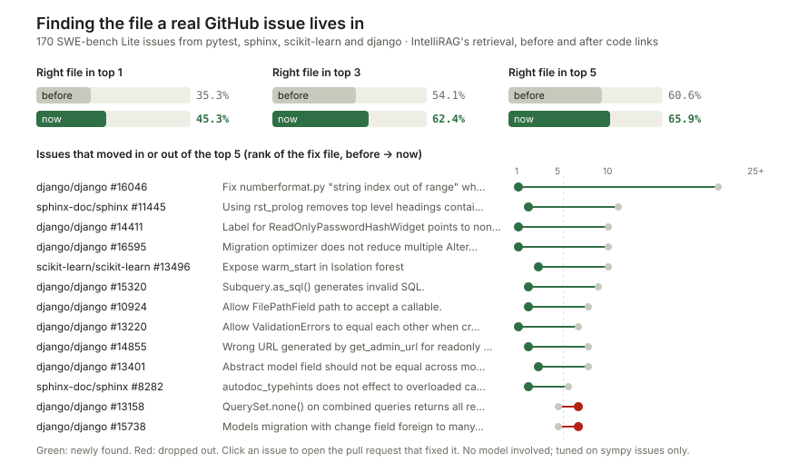

# Real GitHub issues: finding the file the bug lives in



**Task.** These are 170 real issues from four open-source repositories (pytest, sphinx, scikit-learn and django). Each one comes from **SWE-bench Lite** (Jimenez et al., ICLR 2024), along with the pull request that fixed it. IntelliRAG gets the issue text exactly as the reporter wrote it. It ranks the repository's files, and a hit is any file the fixing patch changed. This is file-level localization, as in Agentless and LocAgent.

Each repository is indexed once, at the commit of its earliest issue, so no fix is in the index. Code is chunked the way GitHub import chunks it, by definition. Test files are left out, since fixes live in source files.

| IntelliRAG retrieval | Right file first | In top 3 | In top 5 |
|---|---|---|---|
| before (text match + calibrated rerank) | 35.3% | 54.1% | 60.6% |
| **now (+ code links)** | **45.3%** | **62.4%** | **65.9%** |

That is +10.0 points on the first result. 11 issues moved into the top 5 and 2 moved out. Each one is in the chart, linked to its fixing PR.

**What changed.** Bug reports name their code. A traceback quotes a file, an issue says `Subquery.as_sql()`, and a report mentions `ReadOnlyPasswordHashWidget`. `dev-entities.ts` pulls those names out. A definitions index, built once per repository, links each name to the files that define it, and rare names count for more. Those files' passages join the candidates with a bounded lift in the reranker. LocAgent and Agentless do this entity-linking step with a model; IntelliRAG does it without one.

**How it was tuned.** The lift (0.12 per unit of link strength, capped at 0.3) was chosen on sympy's 77 issues only. Nothing was tuned on the four repositories above.

| Repository | Issues | First, before → now | Top 5, before → now |
|---|---|---|---|
| django | 114 | 36.0 → 47.4 | 64.9 → 70.2 |
| scikit-learn | 23 | 30.4 → 43.5 | 47.8 → 52.2 |
| sphinx | 16 | 25.0 → 31.2 | 50.0 → 62.5 |
| pytest | 17 | 47.1 → 47.1 | 58.8 → 58.8 |

## What didn't work, and what sleep did about it

**Case memory.** I also tested whether resolved issues help with later ones. When a fix lands, its files are filed against the issue's text. A new issue then borrows the files of similar earlier ones, as in BugLocator, with a fix-frequency prior, as in FixCache. Issues were replayed in order, and each was ranked before it was learned from.

| Search-bar ranking | First | Top 5 |
|---|---|---|
| without case memory | 44.7% | 65.9% |
| case memory, fixed weights | 38.2% | 65.9% |
| case memory, weights chosen by sleep | 42.9% | 64.7% |

Real issues are mostly new problems, so borrowing from old ones hurt. The sleep step replays the memory's own history and only adopts weights that would have ranked past answers higher. That cut the damage from −6.5 to −1.8 points on the first result, but it did not turn the memory into a gain. In the app, case memory therefore stays off until replay beats the current weights by 0.05 MRR over at least 20 cases. It is reported here as a negative result.

## Reproduce

```bash
git clone --filter=blob:none --sparse https://github.com/aorwall/moatless-tools /tmp/mt
git -C /tmp/mt checkout 011ead57a5c81664e9c45e07e1f50b17e695cc63
git -C /tmp/mt sparse-checkout set --no-cone moatless/evaluation/swebench_lite_all_evaluations.json
# each repository at its earliest issue's commit (see swe-loc-bench.ts for the SHAs)
for r in "django django e7fd69d051eaa67cb17f172a39b57253e9cb831a" "pytest pytest-dev/pytest 10ca84ffc56c2dd2d9dc4bd71b7b898e083500cd" \
         "sklearn scikit-learn/scikit-learn b90661d6a46aa3619d3eec94d5281f5888add501" "sphinx sphinx-doc/sphinx 752d3285d250bbaf673cff25e83f03f247502021"; do
  set -- $r; [ $1 = django ] && repo=django/django || repo=$2
  mkdir -p /tmp/swe/$1 && git -C /tmp/swe/$1 init -q && git -C /tmp/swe/$1 fetch -q --depth 1 https://github.com/$repo $3 && git -C /tmp/swe/$1 checkout -q FETCH_HEAD
done
cd web && SWE_JSON=/tmp/mt/moatless/evaluation/swebench_lite_all_evaluations.json npx tsx scripts/swe-loc-bench.ts --write
node scripts/issue-chart.mjs
```

The full run takes about 25 minutes on a laptop: django is 4,261 passages.

**For context.** LLM agents that read and navigate the repository score far higher. LocAgent reports up to 92.7% file-level accuracy on SWE-bench Lite with a fine-tuned 32B model. What's measured here is the retrieval step with no model, which is what an agent would call first.
